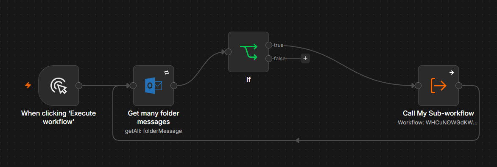
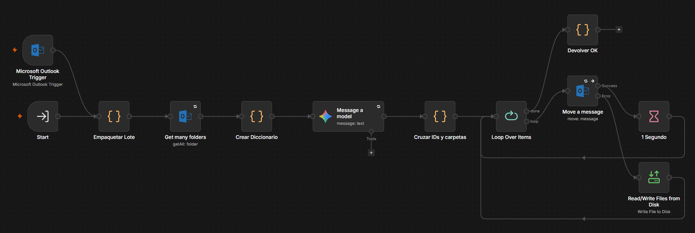
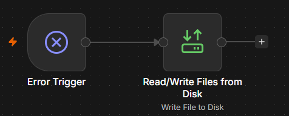

# Autonomous Email Classification & Routing Engine (n8n + Gemini + Microsoft Graph)

A fault-tolerant, event-driven email classification pipeline built on self-hosted **n8n (Docker)**, **Microsoft Graph API (Outlook)**, and **Google Gemini**. 

Rather than relying on a fragile linear script, this project implements distributed systems patterns—**Orchestrator-Worker isolation**, **N-to-1 payload aggregation**, **multi-tier fault tolerance**, and **local Dead-Letter logging**—to process thousands of legacy emails in batches as well as real-time incoming messages without memory leaks or API throttling.

---

## 🏗️ System Topology & Workflows

The system is decoupled into three specialized workflows (available in the [`/workflows`](./workflows) directory):

### 1. Batch Orchestrator (`01_Batch_Orchestrator.json`)
Handles state control and paginated extraction for legacy inbox cleanups (2,000+ emails).
* Fetches unclassified emails from the Inbox in controlled batches of 50 (`Get many folder messages`).
* Evaluates batch availability (`If` node checking `$input.all().length != 0`) to determine loop termination.
* Invokes the Worker sub-workflow (`Call My Sub-workflow`) synchronously (`waitForSubWorkflow: true`), waiting for the `{ continuar: true }` completion signal before fetching the next page.

### 2. Unified Dual-Ingestion Worker (`02_Unified_Classifier_Worker.json`)
The core stateless processing engine, capable of handling both bulk batches and single real-time events.
* **Dual Triggers:** Accepts synchronous invocations from the Batch Orchestrator (`Start`) and asynchronous real-time events (`Microsoft Outlook Trigger`).
* **Centralized Normalization & Aggregation (`Empaquetar Lote`):** Extracts essential metadata (`id`, `remitente`, `asunto`, `snippet`) with fallback parsing and consolidates the entire batch into a single JSON item (`datos_analisis`).
* **Dynamic Taxonomy Resolution (`Get many folders` ➔ `Crear Diccionario`):** Queries Microsoft Graph at runtime to map uppercase folder names to Graph Folder IDs.
* **Batch LLM Inference (`Message a model`):** Sends a single structured prompt to Google Gemini (`jsonOutput: true`) to classify the entire batch in one pass, followed by folder ID mapping (`Cruzar IDs y carpetas`).
* **Controlled Routing Loop (`Loop Over Items`):** Iterates through classified items one by one (`batchSize: 1`), moving each email (`Move a message`) with a 1-second rate-limiting delay (`1 Segundo`), item-level error isolation (`Read/Write Files from Disk`), and final completion signaling (`Devolver OK`).

### 3. Global Catastrophic Error Handler (`00_Global_Error_Handler.json`)
An out-of-band safety net triggered via n8n's `Error Trigger` whenever an unhandled workflow-level crash occurs, writing execution metadata directly to local disk (`/tmp/n8n_errores_graves.txt`).

---

## 🧠 Key Architectural Decisions (ADRs) & Problem Solving

Every structural choice in this pipeline was made to solve specific runtime, memory, or API constraints encountered during development:

### ADR 01: Orchestrator-Worker Decoupling vs. Monolithic Loop
* **The Problem:** Implementing a pagination loop over thousands of emails inside a single n8n workflow causes **item superposition and memory accumulation**. In n8n, nodes inside a long-running loop retain execution data from previous iterations in memory, eventually crashing the Node.js V8 heap (Out-Of-Memory) and mixing items across iterations.
* **The Decision:** Decouple pagination (Parent) from execution (Child Sub-workflow). Once the Child finishes processing a batch and returns `{ continuar: true }`, its execution context is destroyed and garbage-collected before the Parent fetches the next batch.

### ADR 02: N-to-1 Payload Aggregation (Preventing Execution Multiplication)
* **The Problem:** In n8n's execution model, nodes run once *per incoming item*. Passing 50 individual email items into `Call My Sub-workflow` or the `Message a model` (Gemini) node would trigger 50 separate sub-workflow instances or 50 individual LLM API calls, instantly exhausting Google Gemini RPM (Requests Per Minute) quotas and multiplying system prompt token costs by 50x.
* **The Decision:** Collapse the batch of emails into a single consolidated JSON payload (`1 item`) before invoking the worker and LLM. This reduces 50 API calls to **1 single batch inference call**, achieving an average processing speed of ~2.4 seconds per email (~2 minutes per 50-email batch including routing delays).

### ADR 03: Runtime Stateless Dictionary vs. Global `staticData`
* **The Problem:** Initially, `$getWorkflowStaticData('global')` was used to cache the Outlook folder dictionary (`Folder Name -> Folder ID`). However, in n8n, `staticData` is unreliable during manual test executions, creates hidden state dependencies across sub-workflow calls, and fails to reflect newly created folders. Furthermore, `Get many folders` outputs *N* items (e.g., 23 items for 23 folders), which would cause downstream nodes to execute 23 times if left unaggregated.
* **The Decision:** Eliminate global `staticData` entirely. The Worker fetches folders dynamically at runtime (`Get many folders`) and immediately collapses all folder items into a single dictionary object (`return [{ json: { mapa: mapaCarpetas } }]` in `Crear Diccionario`). Downstream nodes reference this map deterministically via `$('Crear Diccionario').first().json.mapa`, ensuring 100% statelessness and preventing item multiplication.

### ADR 04: Dual-Ingestion Consolidation (DRY Principle)
* **The Problem:** Maintaining a separate third workflow purely to listen to incoming emails and forward them to the Worker introduced redundant formatting nodes and extra maintenance overhead.
* **The Decision:** Because both `Get many folder messages` (Batch) and `Microsoft Outlook Trigger` (Real-Time) return the underlying Microsoft Graph `Message` JSON schema, the `Empaquetar Lote` normalization node was placed at the entry point of the Worker sub-workflow, fed by both triggers. Whether the input is a 50-email batch from the Orchestrator or a single real-time email (`1 item`), the exact same pipeline and `Loop Over Items` logic processes it seamlessly (iterating $N$ times for batches, or $1$ time for real-time emails).

---

## 🛡️ Multi-Tier Fault Tolerance & Resilience Strategy

A core focus of this architecture is handling partial and total failures gracefully without human intervention or infinite error loops:

### Tier 1: Transient Network & Batch-Level Failures (`Retry On Fail`)
* **Scope:** `Get many folder messages`, `Get many folders`, and `Message a model` (Gemini).
* **Rationale:** Because the email batch is sent to Gemini as a single indivisible item, an LLM failure or malformed JSON affects the entire batch. Similarly, if `Get many folders` fails, the workflow lacks the routing dictionary (**Critical Dependency Failure**) and must not proceed blindly. Therefore, these nodes do **not** use `Continue On Fail`; instead, they are protected with automatic **Retries on Fail** to absorb transient `HTTP 502/503` micro-outages or rate limits. If all retries fail, the execution halts cleanly and triggers the Tier 3 Global Error Handler.

### Tier 2: Item-Level Poison Pill Isolation (Local Dead-Letter Log)
* **Scope:** `Move a message` (inside the item-by-item `Loop Over Items`).
* **Why we rejected a "Manual Review" Outlook folder:** A common naive pattern is routing failed emails to a `MANUAL_REVIEW` folder in Outlook. However, if `Move a message` fails for a specific item (due to a corrupted message ID, locked resource, or Graph API rejection), immediately calling the exact same `Move a message` API to move it to a quarantine folder will fail for the exact same reason.
* **The Solution:** `Move a message` is configured with `On Error: Continue (using error output)`. 
  * **Success Branch:** Waits 1 second (`1 Segundo`) to respect Microsoft Graph burst limits and loops back.
  * **Error Branch:** Leaves the problematic email untouched in the Inbox, appends the error details and timestamp to a local Dead-Letter file (`/tmp/n8n_errores_correos.txt` using `Write File to Disk` with `Append: true`), and connects back to `Loop Over Items` so the rest of the batch continues uninterrupted.

### Tier 3: Catastrophic Out-of-Band Alerting (Avoiding Circular Dependencies)
* **Scope:** Workflow-level crashes (e.g., expired/revoked Microsoft OAuth2 tokens, exhausted Gemini retries).
* **Why we rejected Email Alerting:** Using an Outlook node inside the `Error Workflow` to notify the administrator creates a **fatal circular dependency**—if the workflow crashed because the Microsoft OAuth token expired, the error handler will also fail to send the alert email, dying silently.
* **The Solution:** Because n8n suppresses the global `Error Trigger` when errors are caught locally via `Continue On Fail`, the `00_Global_Error_Handler` only fires on true unrecovered catastrophes, logging the failure out-of-band to `/tmp/n8n_errores_graves.txt` on the host container.

## 🛠️ Tech Stack & Environment
* **Infrastructure:** Self-hosted Docker container on Ubuntu Server Linux
* **Orchestration Engine:** n8n
* **AI Model:** Google Gemini (`gemini-flash-lite-latest`)
* **API Integration:** Microsoft Graph API (OAuth2 - `Mail.ReadWrite`, `MailboxSettings.Read`)
* **Scripting:** JavaScript (ES6)
